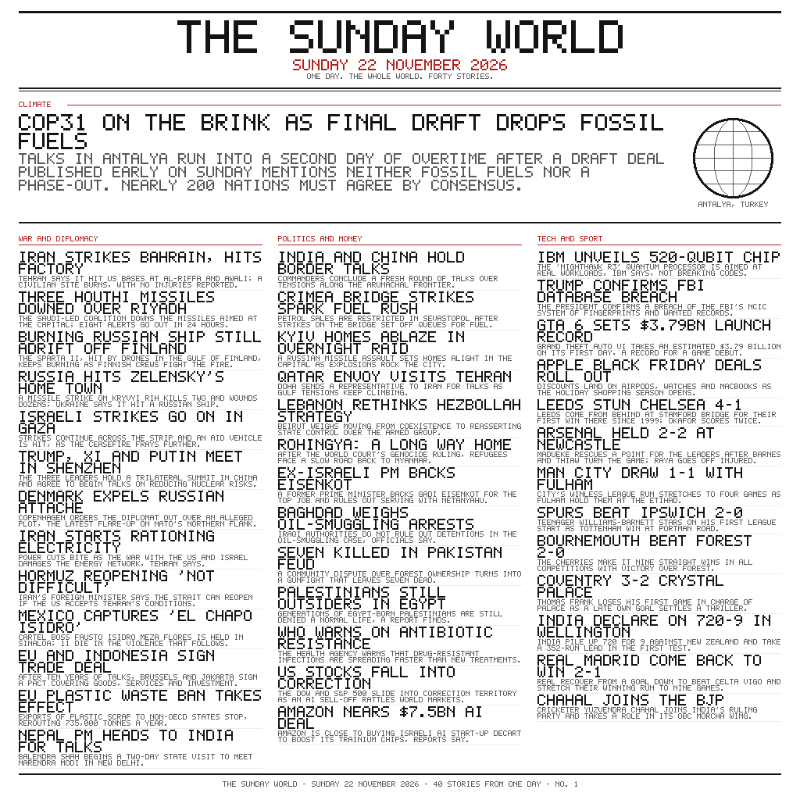

# The Sunday World — 22 November 2026

[](https://make.fun/bounty/news-image-20261122?utm_source=github&utm_medium=readme&utm_campaign=news-image-20261122)
[](https://make.fun/bounty/news-image-20261122/leaderboard?utm_source=github&utm_medium=readme&utm_campaign=news-image-20261122)
[](https://make.fun/bounty/news-image-20261122?utm_source=github&utm_medium=readme&utm_campaign=news-image-20261122)
[](LICENSE)
[](main.py)

An original one-page newspaper summing up the world news of **Sunday 22 November 2026** — 40 real stories, from COP31's fossil-fuel deadlock in Antalya to Leeds' 4-1 win at Stamford Bridge.

Entry for the [make.fun bounty "Sum up 22 November's world news in one image"](https://make.fun/bounty/news-image-20261122) (news-image-20261122, $100 total, top 50).



## How it works

`main.py` (Python 3.13, standard library only) draws the whole page — masthead, lead story, three columns of 13 stories each — with a built-in 5x7 bitmap font and a hand-written PNG encoder. No network, no fonts on disk. It writes `/output/entry.png` (1024x1024, deterministic: two runs produce identical bytes).

```sh
mkdir -p out && MAKEFUN_OUTPUT_DIR=out python3 main.py
```
